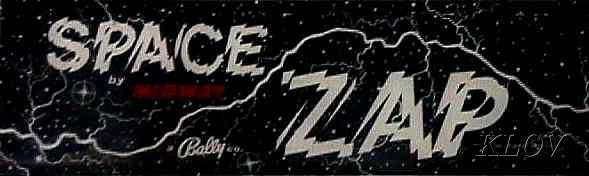
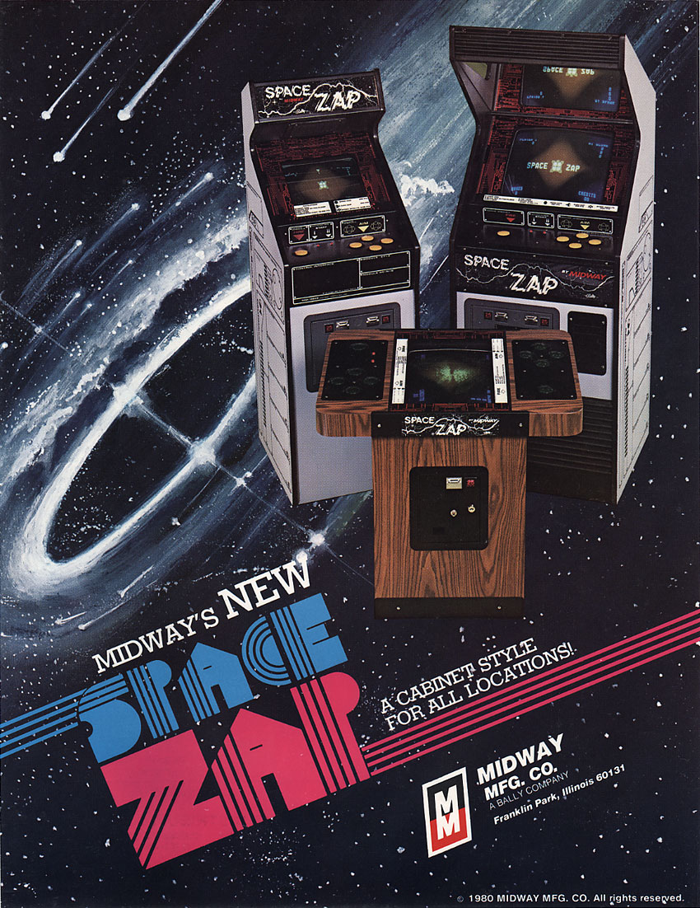
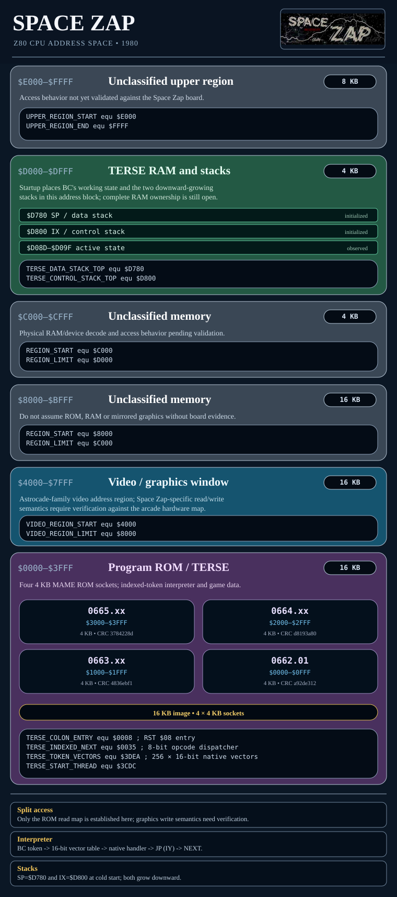
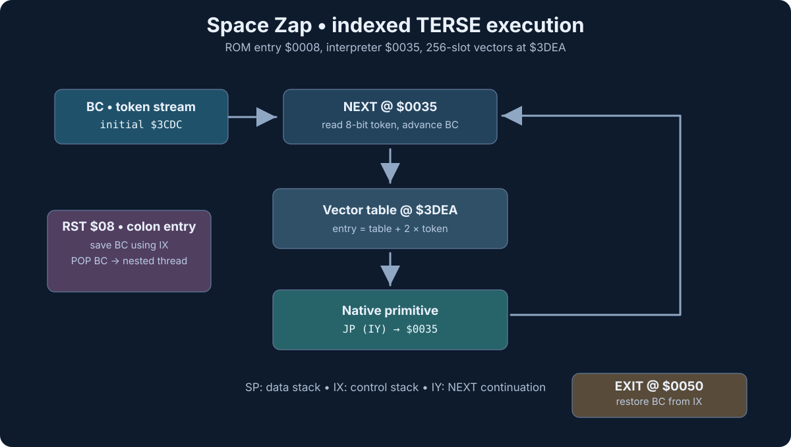

# Space Zap

A byte-exact Z80 reverse-engineering project for **Space Zap** (Midway, 1980), built on an **indexed-token TERSE interpreter** and native Z80 routines.



Space Zap is a four-direction space-defense arcade game. It runs on the Midway Astrocade-family platform. Dave Nutting Associates is credited in historical records; Game-A-Tron is associated with licensing. The individual arcade programmer is not yet established.



| Area | Recovered work |
| --- | --- |
| [Build and ROM identity](#build) | Original 16 KB program, four MAME ROMs, SHA-1 verification |
| [TERSE](#terse-execution-architecture) | Indexed NEXT, 256-word vector table and native Z80 words |
| [Memory and I/O](#memory-map) | 64 KB reference map; verified ROM and TERSE addresses |

## Project layout

| File / directory | Purpose |
| :--- | :--- |
| **[Active RE sprint plan](docs/SPRINT-PLAN.md)** | Remaining P0 hard RE and later WB runtime integration |
| **[Source](Space_Zap_Disassembly.asm)** | Z80 disassembly and recovered TERSE words |
| **[Linux build](build.sh)** / **[Windows build](build.bat)** | Assemble, package and verify |
| **[ROMs](roms/)** | Generated MAME files and separately retained original reference |
| **[TERSE word dictionary](docs/TERSE-WORD-DICTIONARY.md)** | Word definitions, stack effects, examples and native Z80 code |
| **[Token vectors](docs/TERSE-TOKEN-VECTORS.md)** | All 256 native-vector slots |
| **[Runtime architecture and comparison](docs/TERSE-ARCHITECTURE.md)** | Space Zap vs. cartridge threading and exact native primitives |
| **[Manual](docs/Space_Zap_Parts_and_Operating_Manual_(Oct_1980).pdf)** | Original service documentation |
| **[Images](images/)** | Cabinet, marquee and SVG diagrams |

## Build

Build with **zmac**, using the original Z80 assembly source. Linux uses an installed `zmac` or `tools/zmac`; Windows uses the bundled `tools/zmac.exe`.

Linux:
```sh
./build.sh
```

Windows:
```bat
build.bat
```

Both scripts:

1. Assemble `Space_Zap_Disassembly.asm` into the 16 KB image and listing.
2. Split the image into four original 4 KB ROM files.
3. Create `roms/spacezap.zip` for MAME.
4. Verify the generated ROMs against their original SHA-1 hashes.

## Run in MAME

```sh
mame -rompath roms -window -skip_gameinfo spacezap
```

## ROM organization

The four 4 KB sockets form one contiguous Z80 ROM image at `$0000–$3FFF`.

| ROM | Address | CRC32 |
| --- | --- | --- |
| `0662.01` | `$0000–$0FFF` | `a92de312` |
| `0663.xx` | `$1000–$1FFF` | `4836ebf1` |
| `0664.xx` | `$2000–$2FFF` | `d8193a80` |
| `0665.xx` | `$3000–$3FFF` | `3784228d` |

Official ROM SHA-1 values are embedded in both build scripts and checked for every build.

### ROM ZIP ownership

- `roms/original/spacezap.zip` is the checked-in original reference archive.
- `roms/spacezap.zip` is the current tracked MAME output path and is **recreated by the build**. The two ZIPs currently share the same Git blob SHA; they are byte-identical as committed, not alternative game releases.
- The four extracted `roms/0662.01`–`roms/0665.xx` are the program ROMs. After rebuilding, the per-ROM SHA-1 checks—not the ZIP container checksum—prove original ROM identity.
- The ASM `vYYYYMMDD-NNNN` field is the evolving RE source revision, not a distinct Space Zap game version. ZIP container metadata may change independently of its ROM contents.


## Memory map



Four ROM sockets, the TERSE interpreter, its token table, and initial stack locations.

## TERSE execution architecture

Space Zap uses a **one-byte indexed-token TERSE** system. BC points to a byte stream; NEXT at `$0035` uses each byte to select a 16-bit native address from the 256-entry table at `$3DEA`. Native words return through `JP (IY)`.

| Register | TERSE role |
| --- | --- |
| BC | Byte-token instruction pointer, initially `$3CDC` |
| IX | Control/return stack, initially `$D800` |
| SP | Data/Z80 stack, initially `$D780` |
| IY | NEXT continuation, `$0035` |



### TERSE documentation

- [TERSE interpreter architecture](docs/TERSE-ARCHITECTURE.md) — indexed NEXT, execution model, registers and control stacks.
- [TERSE word dictionary](docs/TERSE-WORD-DICTIONARY.md) — recovered names, token addresses, stack effects, examples and native Z80 code.
- [Complete token-vector inventory](docs/TERSE-TOKEN-VECTORS.md) — all 256 token slots.
- [Compiled TERSE programs](docs/TERSE-COMPILED-PROGRAMS.md) — original compiled words and branch operands.
- [Native primitive comparison](docs/TERSE-ARCHITECTURE.md#exact-primitive-level-comparison-with-cartridge-terse) and [XC lineage](docs/TERSE-XC-LINEAGE.md) — exact routine comparisons and original compiler research.

## References

- [Original Space Zap parts and operating manual](docs/Space_Zap_Parts_and_Operating_Manual_(Oct_1980).pdf)
