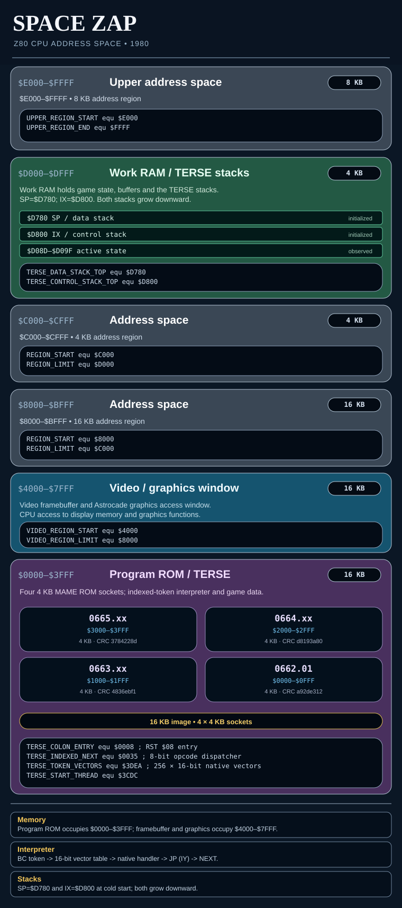

# Space Zap — ROM regions and reverse-engineering notes

ROM organization, assets and native-game-code recovery for the Space Zap arcade disassembly. See the [TERSE interpreter architecture](TERSE-ARCHITECTURE.md) and [TERSE word dictionary](TERSE-WORD-DICTIONARY.md) for the byte-token execution engine.

## ROM region notes

| Address range | Role / status |
| --- | --- |
| `$0000–$0FFF` | ROM X1; startup and TERSE kernel, native routines and other content |
| `$1000–$1FFF` | ROM X2; mixed program/data, not fully typed |
| `$2000–$2FFF` | ROM X3; game objects, sprite records and graphics |
| `$3000–$3FFF` | ROM X4; application data and end-of-ROM token table |
| `$3CDC` | Initial compiled token stream |
| `$3DEA–$3FE9` | 256-entry indexed native handler-vector table |
| `$3FEF` onward | `SPACE ZAP\0DNA\0` and terminal bytes |

## Native source recovery

The original compiled byte-token programs are indexed in
[Compiled TERSE programs](TERSE-COMPILED-PROGRAMS.md), with typed source
labels, inline literal/branch encoding and verified original ROM spans.

The maintained Z80 source now has named and documented TERSE primitives
for literals, stacks, arithmetic, logic, memory, ports, branches and loop
indexes. The indexed 256-entry native vector table is explicit `DW` data;
entries resolving to identified primitive labels are symbolic.

The following complete original-ROM assets are represented as named data
in the assembly:

- 37-glyph, 8×10 pixel font (`$13C4–$1535`), with an inline 1bpp pixel plot
  for each row.
- Screen text records at `$3097–$327B`, including credit/coin prompts,
  both player titles, scoring and game-over messages.
- Original 2bpp bitmap sprite/animation records.
- ROM title, `DNA` identification and `08/19/80` date at `$3FEF–$3FFF`.

The original arcade sound-chip routines include the eight-register reset
at `$1FC9`, oscillator step at `$2034`, noise-envelope step at `$20B5`,
and indexed register writer at `$213E`. These are labeled in source;
their hardware/parameter contracts are in [ROM assets and audio](ROM-ASSETS-AND-AUDIO.md).

### Additional native routine boundaries

The original native arithmetic helpers at `$026A` and `$0273` now
have dedicated labels for two's-complement operations on HL and DE.
The short colon definition at `$027E` is represented as TERSE tokens,
followed by two native interrupt-protected record routines at `$028C`
and `$02DF`.

The 16-byte block at `$0336–$0345` is an eight-entry `DW` table of RAM
addresses (`$D0A1`, `$D0D7`, `$D0D9`, `$D10F`, `$D111`,
`$D12F`, `$D131`, `$D14F`). The native record dispatch immediately
after this table is labeled `NATIVE_EVENT_RECORD_DISPATCH_0346`.

The full `$270D–$2AE0` compiled/data region is now typed in the
assembly and all **980 reconstructed bytes** were compared to the
original ROM. This also eliminates the false Z80 relative branches
that produced repeated zmac v1.3 `Value error` messages.

### Remaining source work

- Continue decoding the remaining colon programs in the middle ROM;
  complete the game-semantic naming of reconstructed words and operands.
- Split and label the remaining native game-state, interrupt, input, display,
  scoring and coin handling code into callable routines.
- Replace the rest of the invalid instruction streams with typed tables,
  graphics or TERSE thread bytes.
- Resolve all native-table target semantics and native-word stack contracts.
- Complete the RAM and I/O ownership map.
- Assemble the modified source using native zmac and compare all four
  generated ROM SHA-1 hashes against the original MAME set.

## ROM data and console adaptation notes

The arcade disassembly includes inline 2bpp sprite rows and records for
laser bases, alien ships, mines and attack satellites. The ROM tail stores
`SPACE ZAP` and `DNA` text. The 256 native-address vector slots at
`$3DEA` are represented as typed `DW` entries in the maintained assembly.

**Space Fortress (1981)** is a separate 4 KB Bally Astrocade cartridge
adaptation of Space Zap. Its released ROM lacks the arcade's recognizable
`JP (IY)` continuation signature; the cartridge has not been identified
as a TERSE program. It is not part of this arcade ROM reconstruction.
