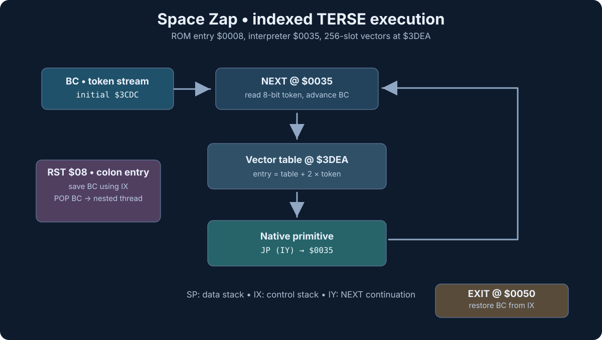
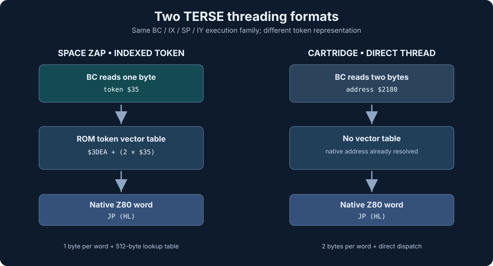
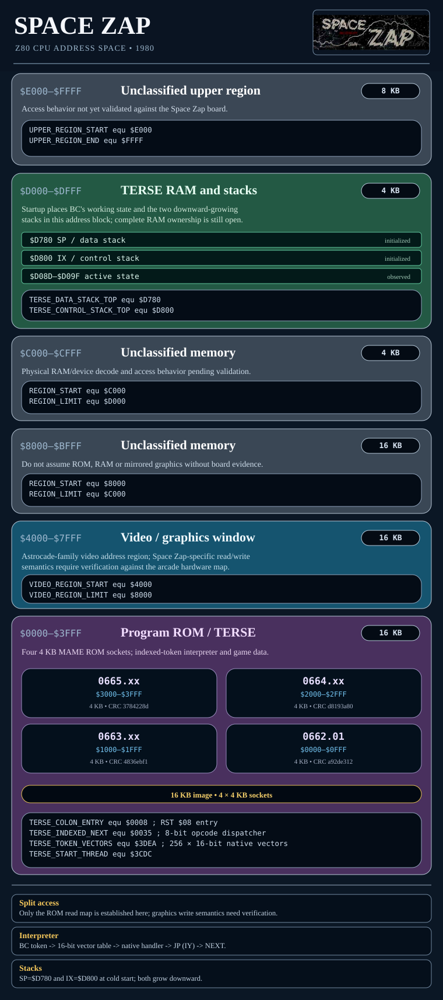

# Space Zap: TERSE runtime and source archaeology
Research checkpoint • 2026-11-07



## Confirmed execution model

The first 16 KB of Space Zap is a Z80 game program with a full
**indexed-token TERSE-family** interpreter, not a generic native-Z80 game.

| Code/data | Address | Verified interpretation |
| --- | --- | --- |
| Colon entry | `$0008` | Preserve previous BC on IX, POP BC from Z80 RST return address, resume IY |
| Cold startup | `$0015` | Set arcade I/O, IX=`$D800`, SP=`$D780`, BC=`$3CDC`, IY=`$0035` |
| Indexed NEXT | `$0035` | Consume **one byte**, double index, select a two-byte native handler address at `$3DEA` |
| EXIT | `$0044` | Restore prior BC through IX, return to IY |
| LIT16 | `$0050` | Fetch little-endian inline word, push HL |
| LIT8 | `$0059` | Fetch zero-extended inline byte, push HL |
| Token address table | `$3DEA` | 256 × 16-bit addresses, filling `$3DEA–$3FE9` |
| Initial stream | `$3CDC` | Starting token stream pointer |

The startup's `LD IY,$0035` makes the dispatch location unambiguous;
each native primitive normally finishes with `JP (IY)`. The original
signature-scan document reports 65, 52, 13 and 9 `JP (IY)` occurrences by ROM,
for 139 total. That count is supporting evidence, not the basis of
classification: the full register, stack and dispatch machine is present.

```z80
; $0035, Space Zap byte-token NEXT
LD A,(BC)
INC BC
LD DE,$3DEA
LD L,A
LD H,$00
ADD HL,HL
ADD HL,DE
LD E,(HL)
INC HL
LD D,(HL)
EX DE,HL
JP (HL)
```

### Same TERSE architecture, different threaded representations



| Property | Space Zap arcade | Coloring Book / Cosmic Raiders |
| --- | --- | --- |
| Execution format | **8-bit indexed token** | **16-bit native execution address** |
| Token dispatch | ROM table lookup `$3DEA + 2×token` | Native address already in thread |
| NEXT | `$0035` | Cartridge `$2050` |
| Colon entry | `$0008` | Cartridge `$2019` |
| EXIT | `$0044` | Cartridge `$2057` |
| LIT16 | `$0050` | Cartridge `$2063` |
| LIT8 | `$0059` | Cartridge `$206C` |
| Thread IP | BC | BC |
| Control stack | IX | IX |
| Data/native stack | SP | SP |
| Primitive continuation | IY / `JP (IY)` | IY / `JP (IY)` |
| Cost | One byte per word reference, plus 512-byte vector table | Two bytes per word reference, simpler NEXT |
| Classic Forth nomenclature | Indexed-token / token-threaded, **not automatically indirect-threaded Forth** | Direct-threaded |

An important distinction for the historical manuscript: this is not
simply one kernel relocated. The **semantics of the execution cell**
are different. Both use a clearly related TERSE ABI; whether a
single original DNA XC could emit both representations, or the
arcade target had a distinct compiler, remains unproven.

The byte-token representation may be smaller for large programs but
adds one native address-table lookup per executed token. No performance
measurements are asserted here.

## The two 688-byte comparisons

The TERSE repository's `spacezap_terse_signature_688.bin` and
`scanner/data/fingerprints/terse-688-reference-window.bin` are the
**same file content** (identical Git blob SHA
`10096c679de019f864095e647036124dca59f7a9`).
It is the **first 688 bytes of Space Zap** (`$0000–$02AF`), a
convenient reference slice, not an independently discovered 688-byte
module boundary. It contains cold start, colon entry, indexed NEXT
and many primitives.

The separate `TERSE_688_runtime_map.txt` describes a *different*
**688-byte shared cartridge window** in Coloring Book and Cosmic
Raiders at reference `$0050–$02FF` (mapped cartridge `$2050–$22FF`),
whose SHA-1 is `e823880952bcb6ff65cfc89b32781a9ace5`.
That exact range is byte-identical between **those two cartridge
prototypes**, not between them and Space Zap.

Shared functionality is supported at the level of colon entry,
NEXT/EXIT, 16- and 8-bit literals, data/return stack organization,
and native continuations. Byte identity, complete word-for-word
identity and original source ancestry **have not been demonstrated**
for Space Zap versus the cartridges. A future comparison should
normalize relocated native address references, classify the opcode
and control-flow behavior of each primitive, and hash
matched routines, not arbitrary equal-size windows.

## ROM region notes

| Address range | Role / status |
| --- | --- |
| `$0000–$0FFF` | ROM X1; startup and TERSE kernel, native routines and other content |
| `$1000–$1FFF` | ROM X2; mixed program/data, not fully typed |
| `$2000–$2FFF` | ROM X3; game objects, sprite records and graphics |
| `$3000–$3FFF` | ROM X4; application data and end-of-ROM token table |
| `$3CDC` | Initial compiled token stream |
| `$3DEA–$3FE9` | 256-entry indexed native handler-vector table |
| `$3FEF` onward | `SPACE ZAP\0DNA\0` and terminal bytes |



**Map caution:** The four low 4 KB ROM sockets and the TERSE
addresses come directly from the source and ROM. The full
64 KB external address decode, video/magic window semantics,
and high RAM aliases require validation against the Space Zap
CPU board schematic and MAME's specific game map; those areas
are deliberately marked provisional in the figure. Do not
carry provisional address labels into hardware documentation
as proven decode.

## Hard-RE work plan and progress

The starting `Space_Zap_Disassembly.asm` is predominantly a machine
disassembly using raw numeric addresses, with existing useful
graphic/object structures and inline 2bpp pixel plots. It is not
fully recovered source. Merely changing randomly disassembled bytes
into code labels would be misleading and could silently change ROMs.

Completed in this checkpoint:
- Identified the startup TERSE registers, byte-token dispatcher,
  colon entry, EXIT, LIT16 and LIT8 in the original assembly.
- Added in-source semantic labels without changing any emitted bytes.
- Preserved and referenced existing structured sprite and inline
  pixel data rather than flattening it back into opcodes.
- Established original MAME member names and known SHA-1 values.
- Added Linux/Windows build scripts following the four-stage
  Sea Wolf II build pattern and failing on ROM SHA-1 mismatches.
- Produced controlled SVG architecture and address-map figures.

Open for subsequent byte-exact RE passes:
- Decode all **256 handler-table slots** and distinguish valid entries,
  repeated targets, sentinel values and data-dependent behavior.
- Trace all reachable native handlers, naming by proven function and
  stack/port side effects, not guessed historical source spelling.
- **DONE:** recover original `SPACE ZAP` / `DNA` signature and trailer as\n  typed ROM bytes rather than false executable instructions.\n- Identify mixed source regions still shown as ordinary Z80 mnemonics
  even when they are actually threaded tokens, pointers, sprite
  records or tables; convert each *bounded* region to typed
  `DB`/`DW` with labels, preserving byte identity.
- Recover TERSE application token streams from `$3CDC`, including
  embedded literals, branch targets and shared native words.
- Audit game state, interrupts, input/coin, sound, graphics and
  magic RAM semantics against the service manual and actual CPU map.
- Compare kernel primitive semantics and original code sequences
  with Sea Wolf II, Gorf, Coloring Book, Cosmic Raiders and Extra Bases.
- Validate both builds on actual Linux and Windows zmac, then run
  `mame -verifyroms spacezap` and a gameplay smoke test.

**Interpretation:** The evidence supports *TERSE-family, byte-token
threaded Space Zap*, not a demonstration that its ROM contains the
original host-side compiler or named developer dictionary.

## ROM data and console adaptation notes

The arcade disassembly includes inline 2bpp sprite rows and records for
laser bases, alien ships, mines and attack satellites. The ROM tail stores
`SPACE ZAP` and `DNA` text. The 256 native-address vector slots at
`$3DEA` are represented as typed `DW` entries in the maintained assembly.

**Space Fortress (1981)** is a separate 4 KB Bally Astrocade cartridge
adaptation of Space Zap. Its released ROM lacks the arcade's recognizable
`JP (IY)` continuation signature; the cartridge has not been identified
as a TERSE program. It is not part of this arcade ROM reconstruction.
