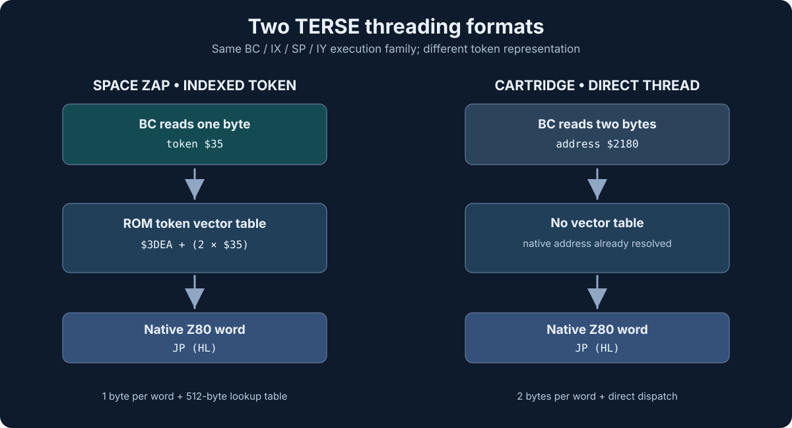

# Primitive-level comparison: Space Zap versus shared cartridge TERSE

**2026-11-07 — recovered ROM/source evidence.**

The common “688 bytes” description does not make the two ROM windows the
same binary. Their dispatch formats differ. But there is **actual opcode-
level commonality in the underlying primitive vocabulary**.

The Space Zap bytes below come directly from the controlled original
`0662.01` ROM, SHA-1
`784ac67c75c7c101f97ebfd39b2b3f7bf7fa470a`.
The corresponding cartridge instruction sequences and native addresses
come from `lizard43/colbook/src/colbook-terse-runtime.asm`, which documents
the byte-exact Coloring Book/Cosmic Raiders shared runtime at
`$2050–$22FF`. These entries can be checked independently against
the surviving cartridge ROMs during native toolchain validation.

## Word-by-word common code

| Word / runtime operation | Space Zap arcade | Cartridge | Bytes | Arcade machine code | Stack / control behavior |
| --- | --- | --- | ---: | --- | --- |
| COLON ENTRY | `$0008` | `$2019` | 13 | `DD 2B DD 70 00 DD 2B DD 71 00 C1 FD E9` | Save caller BC to IX; take RST return address as child thread |
| EXIT | `$0044` | `$2057` | 12 | `DD 4E 00 DD 23 DD 46 00 DD 23 FD E9` | Restore parent BC from IX; return via IY |
| LIT16 | `$0050` | `$2063` | 9 | `0A 03 6F 0A 03 67 E5 FD E9` | Fetch 16-bit inline little-endian literal |
| LIT8 | `$0059` | `$206C` | 8 | `0A 03 6F 26 00 E5 FD E9` | Fetch 8-bit inline literal, zero extend |
| ZERO | `$007B` | `$2084` | 6 | `21 00 00 E5 FD E9` | Push $0000 |
| ONE | `$0081` | `$208A` | 6 | `21 01 00 E5 FD E9` | Push $0001 |
| DUP | `$0087` | `$2090` | 5 | `E1 E5 E5 FD E9` | Duplicate top stack cell |
| 2DUP | `$008C` | `$2095` | 8 | `E1 D1 D5 E5 D5 E5 FD E9` | Duplicate top two cells |
| DROP | `$0094` | `$209D` | 3 | `E1 FD E9` | Discard top stack cell |

**Total: 70 matching instruction bytes across 9 fragments**. The entries
are not claimed to be one uninterrupted 70-byte match.
Each is a bounded primitive/entry. Some location-dependent words elsewhere
may require relocation normalization; these nine are short routines whose
listed opcodes do not embed machine addresses.

The Space Zap and cartridge addresses differ, while these byte bodies
do not. This provides stronger evidence for common runtime code than
shared use of `JP (IY)` alone.

## The nonmatching part is central: NEXT

**Space Zap `$0035`:** `LD A,(BC); INC BC; LD DE,$3DEA; ... JP (HL)`.
A *byte token* selects a native address via a 512-byte vector table
at `$3DEA`. This is an **indexed-token threaded** TERSE model.

**Cartridges `$2050`:** `LD A,(BC); INC BC; LD L,A; LD A,(BC);
INC BC; LD H,A; JP (HL)`. The stream already holds a native
16-bit address. This is **direct-threaded** TERSE.

An architectural design decision changed **the encoded execution cell**,
not the fundamental data/return stack model. The 9 matching routines
are evidence of reuse within the TERSE family, while the different
dispatcher is evidence of a modified execution format.

## Compilation and ancestry hypotheses (not confirmed)

- Both images could descend from one original TERSE native-word library.
- A native XC target might have supported both token encodings, or
  the indexed variant could have used a separate compiler.
- Neither the original XC mode nor the full source dictionary is proven
  by these ROM matches.

Avoid calling Space Zap “classic indirect-threaded Forth”; a one-byte
indexed token selecting a native-vector slot is distinct from a
traditional address-based indirect-threaded code-field model.

## Next detailed RE

1. Use the native zmac build to confirm byte-for-byte original ROM
   equivalence after reconstructing the token vector table as `DW`.
2. Compare the remaining arithmetic/logic/loop/control primitive
   bodies with cartridge and Gorf sources, separating identical
   code from relocated or specialized implementations.
3. Recover used token sequences and inline operands and establish
   execution reachability, stack contracts and game-specific words.
