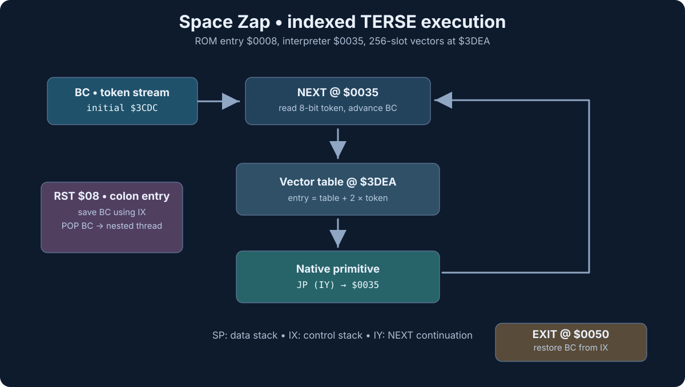

# Space Zap: complete indexed-token native-vector inventory

**Verified ROM:** `roms/0665.xx`, SHA-1 `5aabd720a106158a892368c4920d9cd0f5235e34`.  
**Location:** CPU `$3DEA–$3FE9`, 512 bytes, exactly 256 little-endian vector cells.

## RE status and sprint coverage

**This inventory is not 256 unresolved items.** All 256 original token-vector cells have been extracted from the ROM. Of these, 251 contain in-ROM addresses and five are unused/sentinel cells. The detailed [TERSE word dictionary](TERSE-WORD-DICTIONARY.md) currently documents 36 indexed words, including inline-operand routines and their stack behavior. Rows below are synchronized with these recovered contracts. Remaining `semantics not yet individually recovered` rows describe outstanding semantic RE, not missing ROM bytes.

The [active Space Zap P0 sprint](SPRINT-PLAN.md) explicitly covers auditing every used vector target, its native or colon definition, stack/inline-operand behavior, and updating this inventory and the programmer's dictionary. Near-final runtime integration into DNA TERSE WB follows that work.

## Counts and caveats

- **256** token IDs (`$00–$FF`), each occupying one byte in compiled threads.
- **251** entries have target addresses inside `$0000–$3FFF`.
- **5** entries are the `$FFFF` sentinel and are **not** valid execution targets.
- All 251 in-ROM vector targets are distinct (including the zero-address entry).
- A target address is not automatically a proven TERSE word boundary; some
  addresses may be code joins, ROM-data addresses, or intentionally invalid
  values. `$0000` is particularly suspect and is not labeled a word.
- The table ends at `$3FE9`; bytes `$3FEA–$3FEE` are `FF` padding.
- The following tail is the literal `SPACE ZAP\0DNA\0`, followed by
  `08 19 80` at `$3FFD–$3FFF`. The meaning of those final three
  bytes is not confirmed.

This **complete table** is generated from the checked-in *original ROM
bytes*, not synthetic definitions. The few semantic names shown below are
limited to primitives confirmed by direct disassembly and control flow.

| Token | Native address | RE classification |
| --- | --- | --- |
| `$00` | `$0000` | Zero vector (not demonstrated executable) |
| `$01` | `$008C` | 2DUP: recovered contract in [word dictionary](TERSE-WORD-DICTIONARY.md) |
| `$02` | `$010C` | Native target; semantics not yet individually recovered |
| `$03` | `$01FC` | ZERO_BRANCH: recovered contract in [word dictionary](TERSE-WORD-DICTIONARY.md) |
| `$04` | `$0097` | SWAP: recovered contract in [word dictionary](TERSE-WORD-DICTIONARY.md) |
| `$05` | `$0094` | DROP: recovered contract in [word dictionary](TERSE-WORD-DICTIONARY.md) |
| `$06` | `$0044` | EXIT: recovered contract in [word dictionary](TERSE-WORD-DICTIONARY.md) |
| `$07` | `$0134` | Native target; semantics not yet individually recovered |
| `$08` | `$00B2` | B!: recovered contract in [word dictionary](TERSE-WORD-DICTIONARY.md) |
| `$09` | `$0081` | 1: recovered contract in [word dictionary](TERSE-WORD-DICTIONARY.md) |
| `$0A` | `$025E` | Native target; semantics not yet individually recovered |
| `$0B` | `$007B` | 0: recovered contract in [word dictionary](TERSE-WORD-DICTIONARY.md) |
| `$0C` | `$009D` | @: recovered contract in [word dictionary](TERSE-WORD-DICTIONARY.md) |
| `$0D` | `$0087` | DUP: recovered contract in [word dictionary](TERSE-WORD-DICTIONARY.md) |
| `$0E` | `$0059` | LIT8: recovered contract in [word dictionary](TERSE-WORD-DICTIONARY.md) |
| `$0F` | `$00BF` | +: recovered contract in [word dictionary](TERSE-WORD-DICTIONARY.md) |
| `$10` | `$00AB` | !: recovered contract in [word dictionary](TERSE-WORD-DICTIONARY.md) |
| `$11` | `$FFFF` | Unused/sentinel |
| `$12` | `$040B` | Native target; semantics not yet individually recovered |
| `$13` | `$01E3` | ROT: recovered contract in [word dictionary](TERSE-WORD-DICTIONARY.md) |
| `$14` | `$00D9` | 1+: recovered contract in [word dictionary](TERSE-WORD-DICTIONARY.md) |
| `$15` | `$00D4` | 1-: recovered contract in [word dictionary](TERSE-WORD-DICTIONARY.md) |
| `$16` | `$015F` | BMOVE: recovered contract in [word dictionary](TERSE-WORD-DICTIONARY.md) |
| `$17` | `$10DA` | Native target; semantics not yet individually recovered |
| `$18` | `$10EC` | Native target; semantics not yet individually recovered |
| `$19` | `$11FC` | Native target; semantics not yet individually recovered |
| `$1A` | `$1207` | Native target; semantics not yet individually recovered |
| `$1B` | `$0050` | LIT: recovered contract in [word dictionary](TERSE-WORD-DICTIONARY.md) |
| `$1C` | `$00B7` | ZERO: recovered contract in [word dictionary](TERSE-WORD-DICTIONARY.md) |
| `$1D` | `$0266` | Native target; semantics not yet individually recovered |
| `$1E` | `$027E` | Native target; semantics not yet individually recovered |
| `$1F` | `$01D1` | OUTP: recovered contract in [word dictionary](TERSE-WORD-DICTIONARY.md) |
| `$20` | `$05E5` | Native target; semantics not yet individually recovered |
| `$21` | `$01D9` | INP: recovered contract in [word dictionary](TERSE-WORD-DICTIONARY.md) |
| `$22` | `$0D43` | Native target; semantics not yet individually recovered |
| `$23` | `$016D` | Native target; semantics not yet individually recovered |
| `$24` | `$01B6` | I: recovered contract in [word dictionary](TERSE-WORD-DICTIONARY.md) |
| `$25` | `$00A4` | B@: recovered contract in [word dictionary](TERSE-WORD-DICTIONARY.md) |
| `$26` | `$0188` | Native target; semantics not yet individually recovered |
| `$27` | `$0139` | Native target; semantics not yet individually recovered |
| `$28` | `$2193` | Native target; semantics not yet individually recovered |
| `$29` | `$1F10` | Native target; semantics not yet individually recovered |
| `$2A` | `$042F` | Native target; semantics not yet individually recovered |
| `$2B` | `$21A3` | Native target; semantics not yet individually recovered |
| `$2C` | `$2126` | Native target; semantics not yet individually recovered |
| `$2D` | `$2146` | Native target; semantics not yet individually recovered |
| `$2E` | `$2101` | Native target; semantics not yet individually recovered |
| `$2F` | `$2119` | Native target; semantics not yet individually recovered |
| `$30` | `$2188` | Native target; semantics not yet individually recovered |
| `$31` | `$2162` | Native target; semantics not yet individually recovered |
| `$32` | `$216C` | Native target; semantics not yet individually recovered |
| `$33` | `$20E1` | Native target; semantics not yet individually recovered |
| `$34` | `$219C` | Native target; semantics not yet individually recovered |
| `$35` | `$04A6` | Native target; semantics not yet individually recovered |
| `$36` | `$1216` | Native target; semantics not yet individually recovered |
| `$37` | `$21AA` | Native target; semantics not yet individually recovered |
| `$38` | `$21D8` | Native target; semantics not yet individually recovered |
| `$39` | `$111E` | Native target; semantics not yet individually recovered |
| `$3A` | `$00DE` | ARITH_SHIFT_RIGHT: recovered contract in [word dictionary](TERSE-WORD-DICTIONARY.md) |
| `$3B` | `$112D` | Native target; semantics not yet individually recovered |
| `$3C` | `$20FE` | Native target; semantics not yet individually recovered |
| `$3D` | `$023E` | INDEXED_DISPATCH: recovered contract in [word dictionary](TERSE-WORD-DICTIONARY.md) |
| `$3E` | `$2223` | Native target; semantics not yet individually recovered |
| `$3F` | `$00C5` | -: recovered contract in [word dictionary](TERSE-WORD-DICTIONARY.md) |
| `$40` | `$2154` | Native target; semantics not yet individually recovered |
| `$41` | `$12B1` | Native target; semantics not yet individually recovered |
| `$42` | `$218D` | Native target; semantics not yet individually recovered |
| `$43` | `$00E6` | 1-B!: recovered contract in [word dictionary](TERSE-WORD-DICTIONARY.md) |
| `$44` | `$00EE` | =: recovered contract in [word dictionary](TERSE-WORD-DICTIONARY.md) |
| `$45` | `$01EA` | PICK: recovered contract in [word dictionary](TERSE-WORD-DICTIONARY.md) |
| `$46` | `$01F4` | BRANCH_ABSOLUTE: recovered contract in [word dictionary](TERSE-WORD-DICTIONARY.md) |
| `$47` | `$1F01` | Native target; semantics not yet individually recovered |
| `$48` | `$2350` | Native target; semantics not yet individually recovered |
| `$49` | `$0262` | Native target; semantics not yet individually recovered |
| `$4A` | `$1F08` | Native target; semantics not yet individually recovered |
| `$4B` | `$1237` | Native target; semantics not yet individually recovered |
| `$4C` | `$0149` | AND: recovered contract in [word dictionary](TERSE-WORD-DICTIONARY.md) |
| `$4D` | `$1EF8` | Native target; semantics not yet individually recovered |
| `$4E` | `$013F` | Native target; semantics not yet individually recovered |
| `$4F` | `$0EC7` | Native target; semantics not yet individually recovered |
| `$50` | `$24F6` | Native target; semantics not yet individually recovered |
| `$51` | `$12B7` | Native target; semantics not yet individually recovered |
| `$52` | `$0217` | Native target; semantics not yet individually recovered |
| `$53` | `$1F18` | Native target; semantics not yet individually recovered |
| `$54` | `$0154` | OR: recovered contract in [word dictionary](TERSE-WORD-DICTIONARY.md) |
| `$55` | `$04BB` | Native target; semantics not yet individually recovered |
| `$56` | `$11C3` | Native target; semantics not yet individually recovered |
| `$57` | `$121C` | Native target; semantics not yet individually recovered |
| `$58` | `$1212` | Native target; semantics not yet individually recovered |
| `$59` | `$11A0` | Native target; semantics not yet individually recovered |
| `$5A` | `$11F1` | Native target; semantics not yet individually recovered |
| `$5B` | `$0E11` | Native target; semantics not yet individually recovered |
| `$5C` | `$109C` | Native target; semantics not yet individually recovered |
| `$5D` | `$0E26` | Native target; semantics not yet individually recovered |
| `$5E` | `$0FDC` | Native target; semantics not yet individually recovered |
| `$5F` | `$0FCA` | Native target; semantics not yet individually recovered |
| `$60` | `$0FB8` | Native target; semantics not yet individually recovered |
| `$61` | `$0FA6` | Native target; semantics not yet individually recovered |
| `$62` | `$2393` | Native target; semantics not yet individually recovered |
| `$63` | `$1158` | Native target; semantics not yet individually recovered |
| `$64` | `$0220` | Native target; semantics not yet individually recovered |
| `$65` | `$1195` | Native target; semantics not yet individually recovered |
| `$66` | `$0E31` | Native target; semantics not yet individually recovered |
| `$67` | `$1182` | Native target; semantics not yet individually recovered |
| `$68` | `$1229` | Native target; semantics not yet individually recovered |
| `$69` | `$0F98` | Native target; semantics not yet individually recovered |
| `$6A` | `$10CD` | Native target; semantics not yet individually recovered |
| `$6B` | `$10B7` | Native target; semantics not yet individually recovered |
| `$6C` | `$0CE2` | Native target; semantics not yet individually recovered |
| `$6D` | `$12C7` | Native target; semantics not yet individually recovered |
| `$6E` | `$11B6` | Native target; semantics not yet individually recovered |
| `$6F` | `$24E8` | Native target; semantics not yet individually recovered |
| `$70` | `$11AB` | Native target; semantics not yet individually recovered |
| `$71` | `$1166` | Native target; semantics not yet individually recovered |
| `$72` | `$24FD` | Native target; semantics not yet individually recovered |
| `$73` | `$0D11` | Native target; semantics not yet individually recovered |
| `$74` | `$254C` | Native target; semantics not yet individually recovered |
| `$75` | `$22FA` | Native target; semantics not yet individually recovered |
| `$76` | `$11D0` | Native target; semantics not yet individually recovered |
| `$77` | `$11DB` | Native target; semantics not yet individually recovered |
| `$78` | `$24DA` | Native target; semantics not yet individually recovered |
| `$79` | `$0EDA` | Native target; semantics not yet individually recovered |
| `$7A` | `$0EED` | Native target; semantics not yet individually recovered |
| `$7B` | `$2718` | Native target; semantics not yet individually recovered |
| `$7C` | `$263E` | Native target; semantics not yet individually recovered |
| `$7D` | `$100A` | Native target; semantics not yet individually recovered |
| `$7E` | `$2833` | Native target; semantics not yet individually recovered |
| `$7F` | `$1026` | Native target; semantics not yet individually recovered |
| `$80` | `$282F` | Native target; semantics not yet individually recovered |
| `$81` | `$2837` | Native target; semantics not yet individually recovered |
| `$82` | `$00CD` | MINUS: recovered contract in [word dictionary](TERSE-WORD-DICTIONARY.md) |
| `$83` | `$0E4D` | Native target; semantics not yet individually recovered |
| `$84` | `$0FEE` | Native target; semantics not yet individually recovered |
| `$85` | `$0FFC` | Native target; semantics not yet individually recovered |
| `$86` | `$1055` | Native target; semantics not yet individually recovered |
| `$87` | `$1042` | Native target; semantics not yet individually recovered |
| `$88` | `$1068` | Native target; semantics not yet individually recovered |
| `$89` | `$1077` | Native target; semantics not yet individually recovered |
| `$8A` | `$2866` | Native target; semantics not yet individually recovered |
| `$8B` | `$2855` | Native target; semantics not yet individually recovered |
| `$8C` | `$2877` | Native target; semantics not yet individually recovered |
| `$8D` | `$225E` | Native target; semantics not yet individually recovered |
| `$8E` | `$25D0` | Native target; semantics not yet individually recovered |
| `$8F` | `$2287` | Native target; semantics not yet individually recovered |
| `$90` | `$047E` | Native target; semantics not yet individually recovered |
| `$91` | `$26B6` | Native target; semantics not yet individually recovered |
| `$92` | `$275C` | Native target; semantics not yet individually recovered |
| `$93` | `$0229` | COMPARE_BRANCH_NE: recovered contract in [word dictionary](TERSE-WORD-DICTIONARY.md) |
| `$94` | `$006B` | ADD_INLINE16: recovered contract in [word dictionary](TERSE-WORD-DICTIONARY.md) |
| `$95` | `$1188` | Native target; semantics not yet individually recovered |
| `$96` | `$26E6` | Native target; semantics not yet individually recovered |
| `$97` | `$2704` | Native target; semantics not yet individually recovered |
| `$98` | `$26D2` | Native target; semantics not yet individually recovered |
| `$99` | `$2AE2` | Native target; semantics not yet individually recovered |
| `$9A` | `$26EB` | Native target; semantics not yet individually recovered |
| `$9B` | `$2709` | Native target; semantics not yet individually recovered |
| `$9C` | `$26D7` | Native target; semantics not yet individually recovered |
| `$9D` | `$26F0` | Native target; semantics not yet individually recovered |
| `$9E` | `$26FA` | Native target; semantics not yet individually recovered |
| `$9F` | `$26DC` | Native target; semantics not yet individually recovered |
| `$A0` | `$26F5` | Native target; semantics not yet individually recovered |
| `$A1` | `$26FF` | Native target; semantics not yet individually recovered |
| `$A2` | `$26E1` | Native target; semantics not yet individually recovered |
| `$A3` | `$11E6` | Native target; semantics not yet individually recovered |
| `$A4` | `$2AF6` | Native target; semantics not yet individually recovered |
| `$A5` | `$12DB` | Native target; semantics not yet individually recovered |
| `$A6` | `$113C` | Native target; semantics not yet individually recovered |
| `$A7` | `$10FE` | Native target; semantics not yet individually recovered |
| `$A8` | `$114A` | Native target; semantics not yet individually recovered |
| `$A9` | `$110E` | Native target; semantics not yet individually recovered |
| `$AA` | `$1091` | Native target; semantics not yet individually recovered |
| `$AB` | `$2635` | Native target; semantics not yet individually recovered |
| `$AC` | `$231D` | Native target; semantics not yet individually recovered |
| `$AD` | `$1086` | Native target; semantics not yet individually recovered |
| `$AE` | `$261F` | Native target; semantics not yet individually recovered |
| `$AF` | `$2C26` | Native target; semantics not yet individually recovered |
| `$B0` | `$2508` | Native target; semantics not yet individually recovered |
| `$B1` | `$2D7D` | Native target; semantics not yet individually recovered |
| `$B2` | `$2CB2` | Native target; semantics not yet individually recovered |
| `$B3` | `$2D19` | Native target; semantics not yet individually recovered |
| `$B4` | `$2C4E` | Native target; semantics not yet individually recovered |
| `$B5` | `$2BC0` | Native target; semantics not yet individually recovered |
| `$B6` | `$24BB` | Native target; semantics not yet individually recovered |
| `$B7` | `$3076` | Native target; semantics not yet individually recovered |
| `$B8` | `$1537` | Native target; semantics not yet individually recovered |
| `$B9` | `$3091` | Native target; semantics not yet individually recovered |
| `$BA` | `$307C` | Native target; semantics not yet individually recovered |
| `$BB` | `$30B2` | Native target; semantics not yet individually recovered |
| `$BC` | `$30CD` | Native target; semantics not yet individually recovered |
| `$BD` | `$1679` | Native target; semantics not yet individually recovered |
| `$BE` | `$1692` | Native target; semantics not yet individually recovered |
| `$BF` | `$31EC` | Native target; semantics not yet individually recovered |
| `$C0` | `$31CB` | Native target; semantics not yet individually recovered |
| `$C1` | `$3201` | Native target; semantics not yet individually recovered |
| `$C2` | `$00FD` | U>=: recovered contract in [word dictionary](TERSE-WORD-DICTIONARY.md) |
| `$C3` | `$0209` | Native target; semantics not yet individually recovered |
| `$C4` | `$1306` | Native target; semantics not yet individually recovered |
| `$C5` | `$32B0` | Native target; semantics not yet individually recovered |
| `$C6` | `$3358` | Native target; semantics not yet individually recovered |
| `$C7` | `$3214` | Native target; semantics not yet individually recovered |
| `$C8` | `$3206` | Native target; semantics not yet individually recovered |
| `$C9` | `$32EA` | Native target; semantics not yet individually recovered |
| `$CA` | `$0E40` | Native target; semantics not yet individually recovered |
| `$CB` | `$3405` | Native target; semantics not yet individually recovered |
| `$CC` | `$3141` | Native target; semantics not yet individually recovered |
| `$CD` | `$30E7` | Native target; semantics not yet individually recovered |
| `$CE` | `$1EF1` | Native target; semantics not yet individually recovered |
| `$CF` | `$23A9` | Native target; semantics not yet individually recovered |
| `$D0` | `$3591` | Native target; semantics not yet individually recovered |
| `$D1` | `$34A2` | Native target; semantics not yet individually recovered |
| `$D2` | `$0120` | Native target; semantics not yet individually recovered |
| `$D3` | `$35E3` | Native target; semantics not yet individually recovered |
| `$D4` | `$317B` | Native target; semantics not yet individually recovered |
| `$D5` | `$3189` | Native target; semantics not yet individually recovered |
| `$D6` | `$35B2` | Native target; semantics not yet individually recovered |
| `$D7` | `$3222` | Native target; semantics not yet individually recovered |
| `$D8` | `$35D1` | Native target; semantics not yet individually recovered |
| `$D9` | `$34CC` | Native target; semantics not yet individually recovered |
| `$DA` | `$359A` | Native target; semantics not yet individually recovered |
| `$DB` | `$32A8` | Native target; semantics not yet individually recovered |
| `$DC` | `$34BE` | Native target; semantics not yet individually recovered |
| `$DD` | `$300C` | Native target; semantics not yet individually recovered |
| `$DE` | `$346F` | Native target; semantics not yet individually recovered |
| `$DF` | `$33C1` | Native target; semantics not yet individually recovered |
| `$E0` | `$332E` | Native target; semantics not yet individually recovered |
| `$E1` | `$328A` | Native target; semantics not yet individually recovered |
| `$E2` | `$327C` | Native target; semantics not yet individually recovered |
| `$E3` | `$3377` | Native target; semantics not yet individually recovered |
| `$E4` | `$35C4` | Native target; semantics not yet individually recovered |
| `$E5` | `$21E3` | Native target; semantics not yet individually recovered |
| `$E6` | `$28AA` | Native target; semantics not yet individually recovered |
| `$E7` | `$245E` | Native target; semantics not yet individually recovered |
| `$E8` | `$22CA` | Native target; semantics not yet individually recovered |
| `$E9` | `$3520` | Native target; semantics not yet individually recovered |
| `$EA` | `$3541` | Native target; semantics not yet individually recovered |
| `$EB` | `$2495` | Native target; semantics not yet individually recovered |
| `$EC` | `$2407` | Native target; semantics not yet individually recovered |
| `$ED` | `$34A5` | Native target; semantics not yet individually recovered |
| `$EE` | `$35EF` | Native target; semantics not yet individually recovered |
| `$EF` | `$3BD9` | Native target; semantics not yet individually recovered |
| `$F0` | `$2231` | Native target; semantics not yet individually recovered |
| `$F1` | `$2F67` | Native target; semantics not yet individually recovered |
| `$F2` | `$1311` | Native target; semantics not yet individually recovered |
| `$F3` | `$1F92` | Native target; semantics not yet individually recovered |
| `$F4` | `$1F20` | Native target; semantics not yet individually recovered |
| `$F5` | `$01BF` | Native target; semantics not yet individually recovered |
| `$F6` | `$2DE3` | Native target; semantics not yet individually recovered |
| `$F7` | `$3BFC` | Native target; semantics not yet individually recovered |
| `$F8` | `$2ED6` | Native target; semantics not yet individually recovered |
| `$F9` | `$3452` | Native target; semantics not yet individually recovered |
| `$FA` | `$3C6B` | Native target; semantics not yet individually recovered |
| `$FB` | `$0394` | Native target; semantics not yet individually recovered |
| `$FC` | `$FFFF` | Unused/sentinel |
| `$FD` | `$FFFF` | Unused/sentinel |
| `$FE` | `$FFFF` | Unused/sentinel |
| `$FF` | `$FFFF` | Unused/sentinel |

