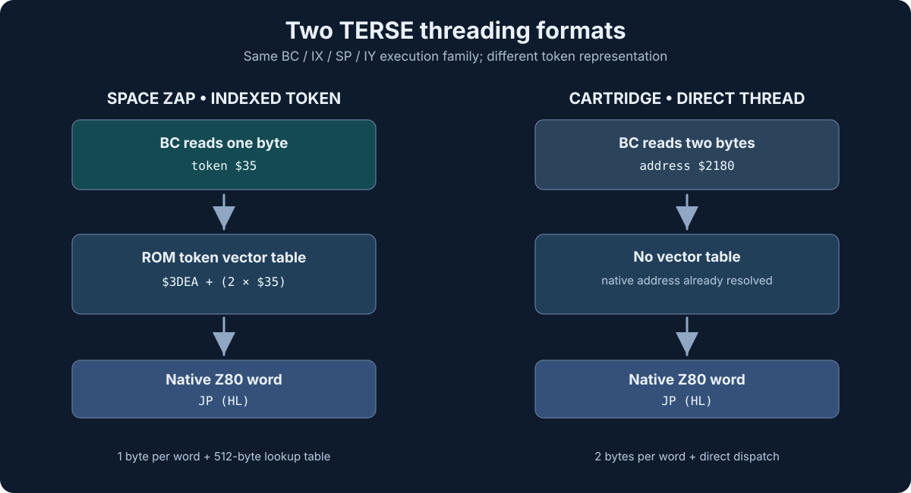

# Space Zap and the recovered DNA XC families

**Research checkpoint — 2026-11-07.** Sources examined in
[lizard43/dnaTERSE-WB](https://github.com/lizard43/dnaTERSE-WB).
This analysis compares preserved XC source and documented native behavior;
it does not claim recovery of Space Zap's original XC disk.

## Conclusion

**Best supported hypothesis:** Space Zap was compiled by a
**byte-token TERSE XC target configuration** closely related in mechanism
to Extra Bases, with a shared TERSE primitive library. The original XC
tools found in the WB demonstrate both indexed-byte and direct-address
target emission. Therefore a separate new high-level programming language
is not required to explain the ROM.

The specific **historical compiler version** used for Space Zap is
not identified. The existing reconstructed XC source is evidence of the
*mechanism*, not proof that its exact archived binary produced Space Zap.



## Inspectable XC source evidence

| WB file | Source mechanism | Significance |
| --- | --- | --- |
| [recovered-core.terse](https://github.com/lizard43/dnaTERSE-WB/blob/main/src/xc-1979/recovered-core.terse) | `bytarray`, `newbyt`, `byt,`, plus target CODE execution handles | Assigns/reuses 8-bit vocabulary numbers when byte-threading is enabled |
| [1982-interpret.terse](https://github.com/lizard43/dnaTERSE-WB/blob/main/src/xc-1979/1982-interpret.terse) | `G79-interpret` emits `byt,` for compiled native target definitions | Native TERSE source becomes a byte-token stream |
| [1982-finalize.terse](https://github.com/lizard43/dnaTERSE-WB/blob/main/src/xc-1979/1982-finalize.terse) | `G79-XCEND` writes the `bytarray` handler list and patches the table pointer | Explains the 16-bit vector-table tail in byte-threaded ROMs |
| [Extra Bases runtime.terse](https://github.com/lizard43/dnaTERSE-WB/blob/main/src/project-tools/extra-bases/runtime.terse) | Seeds a set of native addresses into `bytarray`; selects byte threading | Concrete known game target using the indexed model |
| [console-target.terse](https://github.com/lizard43/dnaTERSE-WB/blob/main/runtime/components/astrocade-console/xc/console-target.terse) | `0 G79-BYTERSE !` | Console target explicitly disables byte-token output |
| [console-interpret.terse](https://github.com/lizard43/dnaTERSE-WB/blob/main/runtime/components/astrocade-console/xc/console-interpret.terse) | Emits native execution cells through `G79-,` | Direct-threaded cartridge output |
| [COMPILER-DICTIONARY.md](https://github.com/lizard43/dnaTERSE-WB/blob/main/docs/COMPILER-DICTIONARY.md) | A working Extra Bases build uses a seeded vocabulary and allocates further word slots | The indexed compiler mechanism is known to be operational |

### Representative source

From the recovered/adapted XC:

```forth
0 ARRAY bytarray
: newbyt ... bytarray ! ... ;
: byt, ... bytarray @ ... newbyt ... ;
: G79-XCEND G79-BYTERSE @ IF
    G79-HERE .bytbase. 1+ G79-U!
    0 G79-,
    G79-BYTERSE @ 1 DO I bytarray @ G79-, LOOP
THEN ... ;
```

The console target instead specifies:

```forth
0 G79-BYTERSE !
```

Its separate interpreter emits address cells via `G79-,`. These are
real native TERSE XC source configurations, rather than a proposed
JavaScript translation of compiled bytes.

## ROM evidence that fits this mechanism

Space Zap's `$0035` NEXT reads one byte from BC, doubles it, adds
`$3DEA`, retrieves a native 16-bit address and jumps to it. The
entire 256-slot table at `$3DEA–$3FE9` is now typed in the assembly
and recorded [slot by slot](TERSE-TOKEN-VECTORS.md). Five slots have
`$FFFF` sentinels; 251 contain distinct ROM addresses.

The [primitive comparison](TERSE-PRIMITIVE-COMPARISON.md) identifies
nine corresponding low-level words with **70 matching machine-code bytes**
between Space Zap and the direct-threaded cartridge runtime. Those
bodies cover colon entry, EXIT, literal widths, constants, and basic
stack operations. Such bounded instruction matches support common
TERSE runtime *implementation code*, not merely shared design terminology.

## Why the coincidental 688-byte lengths do not prove identity

- Space Zap's archived signature is an **arbitrary first 688-byte
  ROM window** (`$0000–$02AF`).
- Coloring Book and Cosmic Raiders have a **shared 688-byte runtime
  span** in their cartridge implementation (`$2050–$22FF`).
- The **Space Zap NEXT** in the first window reads a one-byte token
  then consults a vector table; the **cartridge NEXT** reads a
  two-byte native address and branches directly.
- Therefore the windows are *not merely address-relocated copies*;
  their format differences change the interpreter.
- The corresponding primitive bodies are more meaningful evidence
  of common ancestry than the matching length.

## Historical XC pedigree: what remains open

**Established from maintained source:** An XC targeting one-byte
native-vector tokens exists in the recovered/adapted DNA TERSE system.
An explicitly configured direct-address target also exists; Extra Bases
is a concrete byte-token application.

**Inferred from Space Zap ROM:** Its byte-threaded program was
plausibly produced by a similar compiler family or configuration.
Matching native words suggest reuse of a core kernel vocabulary.

**Not established:** That Space Zap's original development environment
used the same **binary XC image**, identical source screens, or any
specific surviving disk presently loaded by WB. No original
Space Zap compiler artifact has been recovered here.

## Next RE proof points

1. Compare the ordered native handler addresses and kernel word bodies
   with Extra Bases, with relocation-normalized fingerprints.
2. Decode the initial Space Zap token program at `$3CDC` into named
   words and inline parameters, then use the native XC vocabulary
   model to test the encoding hypothesis.
3. If any Space Zap archival disks/source emerge, inspect original
   `XCLOAD`, `XCEND`, `BYTERSE` and `bytarray` bindings rather
   than retrofitting a new compiler.
4. Verify any amended source by executing zmac and comparing all
   four original ROM SHA-1 hashes. Do not claim that a reconstructed
   compiler generated historical bytes without native evidence.

**Engineering rule:** Preserve original DNA software and original
language behavior. Do not replace TERSE compilation with synthetic
JavaScript/Python opcode rewriting, and do not modify the original
historical XC binaries to force the hypothesis.
